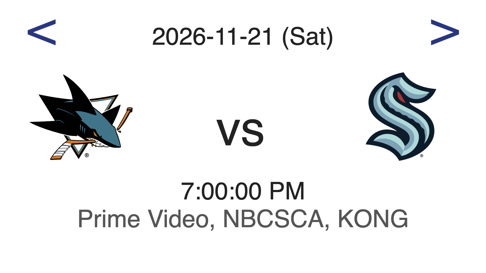

# NHL Today

Shows what NHL games are on today for your favorite team, with the TV channels they're on. Follows the system's light or dark mode.

Live at [andrewmacheret.com/projects/nhl](https://andrewmacheret.com/projects/nhl/).

<picture>
  <source media="(prefers-color-scheme: dark)" srcset="www/screenshot-dark.png">
  
</picture>

## Usage

Pick a team and date with query parameters:

- `team`: the team's name without the city, in lower case, like `sharks` or `maple leafs`. Defaults to `sharks`.
- `date`: `YYYY-MM-DD`. Defaults to today.

For example, [`?team=maple%20leafs&date=2026-11-21`](https://andrewmacheret.com/projects/nhl/?team=maple%20leafs&date=2026-11-21). The `<` and `>` links move a day back or forward.

## How it works

It's a static page in `www/` that uses jQuery. Game data and logo URLs come from [andrewmacheret/nhl-server-lambda](https://github.com/andrewmacheret/nhl-server-lambda) at `https://nhl.andrewmacheret.com`.

That API only allows requests from `https://andrewmacheret.com` (CORS), so opening `www/index.html` locally shows a blank page. To try changes locally, point `apiUrl` in `www/index.js` at a local copy of the server, or proxy the API.

## Deploy

Pushes to `master` copy `www/` to `s3://andrewmacheret.com/projects/nhl` and clear the CloudFront cache through GitHub Actions (see `.github/workflows/deploy.yml`). The workflow signs in to AWS with GitHub OIDC using the IAM role in the `AWS_ROLE_ARN` repo variable.

`www/screenshot.png` is used for this README and for link previews (`og:image`). `www/screenshot-dark.png` is the README screenshot for GitHub's dark theme.
